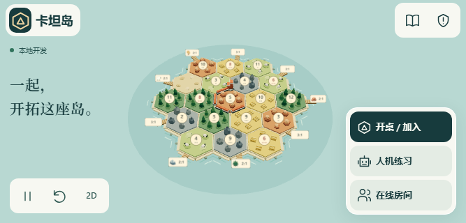

# 首页岛屿展示验收 · 2026-11-06

基于 `qiuh23/catan-friends` main `69e115519ff34813923859d960ee217cac703c40`，分支 `codex/home-island-showcase`。开始前读取 AGENTS.md、DESIGN.md，检查现有 Catan 工作区均无未提交改动；使用独立工作区，未改动其他分支。

## 首页行为

- 海面与画布仍然铺满屏幕。通过 ResizeObserver、字体加载和视口事件，测量标题、副标题、服务器提示、入口、视角控件与 safe-area 的真实边界，再用离轴投影构图。低高度隐藏副标题；短横屏将介绍与控件放左边、入口放右边，保留中央岛屿空间。
- 首页单独使用覆盖地形、建筑和全部港口标牌四角的旋转包围范围。自动镜头固定约 45° 俯角、300 秒一圈，不反复缩放或摇摆。地图点击、触摸、拖动、滚轮、键盘缩放立即暂停；可点「恢复展示」或复位。
- 30 秒演示：村庄出现 → 四段相连道路依次生长 → 村庄收起、城市升起 → 停留 → 缓慢收起并重置。没有烟花、弹跳或完整对局模拟。道路与建筑通过共享 `src/pieces.js` 使用对局原有几何和材质；每轮只修改已创建实例组的变换与可见性。
- `createHomeExample()` 只创建本地示例数据，不引用 Room、Connection、游戏动作或行动反馈。等待房继续使用原来的空岛预览。进入连接/房间时清除展示实例、计时器和首页视角；对局保存/恢复仍按原房间逻辑执行。
- 弹窗打开、页面隐藏时停止动画时钟，恢复时不补播经过的时间。2D、减少动态效果显示已建成的静态示例。切换渲染器、离开页面与销毁时释放实例和 WebGL 资源；浏览器返回缓存恢复时重建视图。手机展示上限 20 次更新/秒，桌面 24 次/秒，保留原来的 DPR、阴影与低功耗策略。

## 本地验收

环境是这台 Windows 电脑上的 Playwright Chromium/WebKit。桌面是电脑浏览器自动化；所有手机、触屏、刘海/底部安全区均为浏览器模拟，**没有物理手机或真机 Safari 测试**。

| 检查 | 结果 |
| --- | --- |
| `npm test` | 147/147 通过，包括新示例数据隔离、时序、实测留白及整圈港口投影测试 |
| `npm run build` / `npm run worker:check` | 构建及 Worker 打包预演通过，无发布 |
| `npm run test:home` | Chromium + WebKit 各 6 种尺寸：1440×1000、1366×768、390×844、320×568、844×390、667×320 |
| 整圈构图 | 每个引擎/尺寸检查 24 个方位；投影实际地形实例、树木、建筑和数字/港口 billboard 四角，检查可见区域和 HUD 互不覆盖；单元测试额外每 5° 检查一次 |
| 交互与暂停 | 点击/触摸、拖动、缩放、键盘、恢复/复位、弹窗、页面隐藏、减少动态、2D/3D、页面离开清理通过 |
| 服务器与安全区 | 阿里云/Cloudflare 文案及大厅入口的模拟部署响应通过；Chromium 模拟竖屏 44/34px、横屏 44/44/21px 安全区及双指缩放通过 |
| 资源稳定 | 每引擎连续运行超过 92 秒（3 个真实时间循环），预热后资源计数保持稳定；再执行 12 个加速姿态循环，地形/建筑重建计数及场景对象数不增长；首页建房请求和房间 WebSocket 均为 0 |
| 现有入口 | `entry-design-browser.js` 的 10 个 Chromium/WebKit 场景通过；`entry-design-flows.js` 的真实本地创建/加入/练习、两条服务器链接与跨服拒绝通过 |
| 现有对局 | `view-recovery-browser.js` 的 3 种尺寸通过；`immersive-polish-browser.js` 对局部分的真人/练习暂停、必选弃牌、结算、重开、草稿与浮窗通过（两引擎、12 张截图） |
| 真实本地房间 | 首页操作后创建真人等待房、朋友加入、补电脑并开局、返回首页、开始三人练习通过；进入房间无展示层/计时器，等待镜头稳定，无首页行动提示；另检 4 份本地存档没有示例标记 |

机器可读结果见 [results.json](qa/home-showcase/results.json)。长时间资源检查预热了所有模型后再取基线，避免把首次上传屋顶几何误当成泄漏。

首页专用脚本只在本地 Vite 响应中注入实例引用，以投影真实几何、固定截图方位和相位；产品代码没有测试控制入口。截图方位为 0°/90°/180°/270°，演示相位分别为第 3/11/21/26 秒；另有连续运行的真实时钟检查。页面隐藏用 document visibility 覆盖模拟；WebKit 手机模式不支持 Playwright 原生滚轮，其滚轮事件单独以 DOM 模拟，仍测试原生触摸点击和键盘缩放。Chromium 另通过 CDP 发送双指触摸事件。这些模拟均不等于真机手势和系统切换。

本机另有 Vite 服务占用默认热更新端口，验收关闭了测试页的热更新传输，保留样式与应用模块。已有对局脚本使用其原有本地规则/WebSocket 夹具；新建房/加入/开局/练习检查连接实际本地 Node 服务。未接触生产房间。

## 关键角度截图

以下图片已逐张查看，文字、入口和完整港口没有相互遮挡或被屏幕裁切。

| 尺寸 | 村庄 · 0° | 道路 · 90° | 城市 · 180° | 重置前 · 270° |
| --- | --- | --- | --- | --- |
| 桌面 | [截图](qa/home-showcase/desktop-0.png) | [截图](qa/home-showcase/desktop-90.png) | [截图](qa/home-showcase/desktop-180.png) | [截图](qa/home-showcase/desktop-270.png) |
| 手机竖屏 | [截图](qa/home-showcase/portrait-0.png) | [截图](qa/home-showcase/portrait-90.png) | [截图](qa/home-showcase/portrait-180.png) | [截图](qa/home-showcase/portrait-270.png) |
| 短横屏 | [截图](qa/home-showcase/short-landscape-0.png) | [截图](qa/home-showcase/short-landscape-90.png) | [截图](qa/home-showcase/short-landscape-180.png) | [截图](qa/home-showcase/short-landscape-270.png) |

其他截图：[2D 静态](qa/home-showcase/portrait-2d.png)、[减少动态效果](qa/home-showcase/portrait-reduced-motion.png)、[横屏安全区](qa/home-showcase/landscape-safe-area.png)。修改前：[桌面](qa/home-showcase/before-desktop.png)、[竖屏](qa/home-showcase/before-portrait.png)、[短横屏](qa/home-showcase/before-short-landscape.png)。

## 发布

`.github/workflows/checks.yml`、`release.yml`、`scripts/deploy/`、`ops/`、`server/`、`worker/`、`shared/` 均无改动。沿用 main 合并 → 必要 Checks 成功 → 受检查产物发布阿里云与 Cloudflare 的现有链路。不增加远端 CI、不手动触发远端 workflow、不新增发布者。本次交付为 PR，合并与生产发布状态以 GitHub 及线上回读为准。
