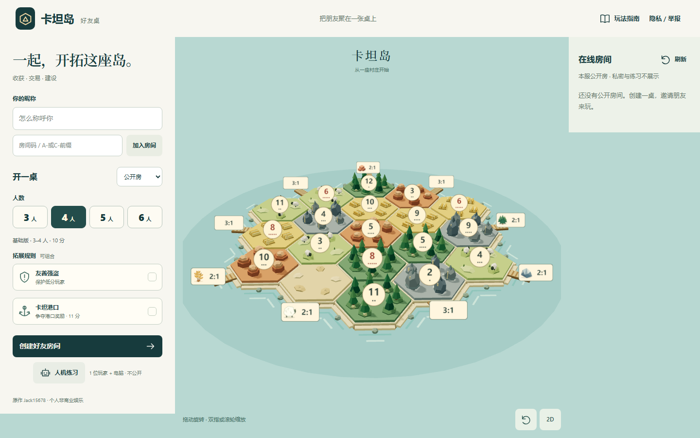
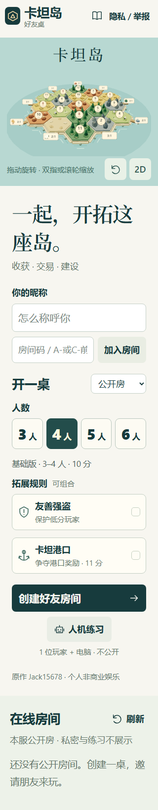
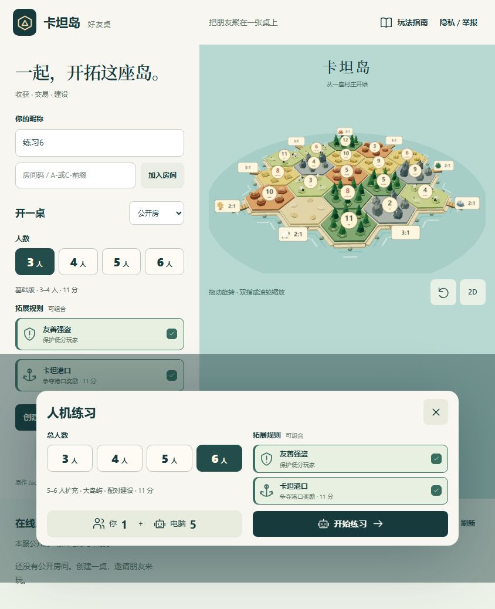
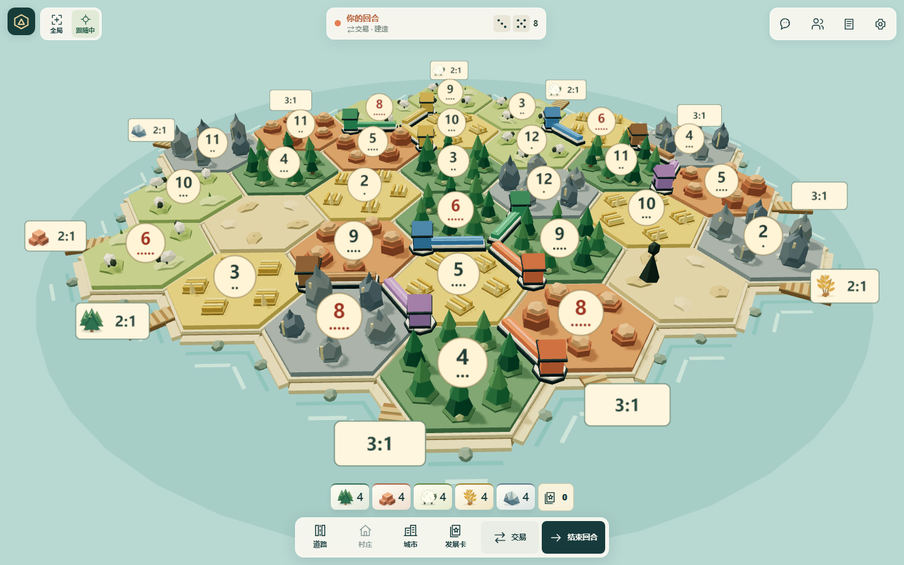
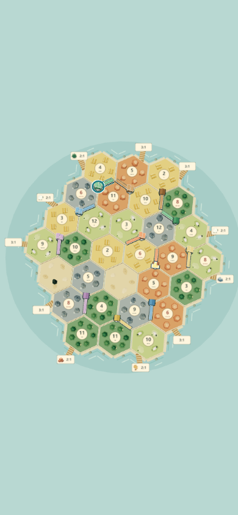
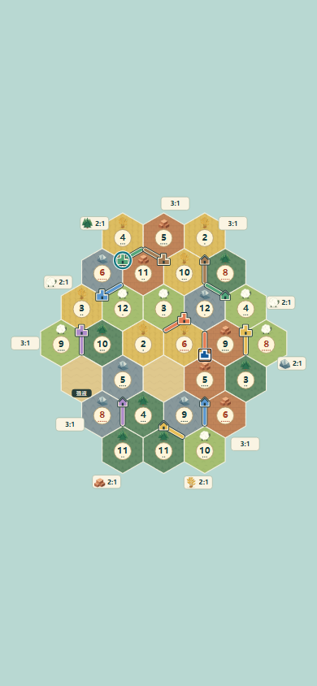
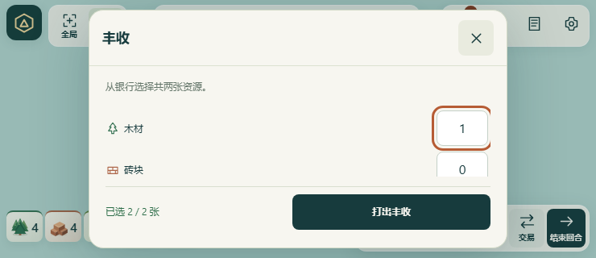

# 精简对局 UI 与人数选择验收

本次从 `origin/main` 的 `35630cd` 开始，使用独立工作树 `C:\Game\CatanFriends-immersive-ui`、分支 `codex/immersive-ui`。开始时已检查全部 Catan 工作树、未提交改动、远端 PR 与任务状态；旧工作树均干净，Catan 旧任务空闲。没有修改其他任务，原有 5175 进程保持不动。

## 最终行为

- 首页标题、完整棋盘和底部手势/视角按钮占各自布局区域。取消负边距和重叠的绝对定位文案；棋盘沿用现有港口边界适配，不靠层级遮盖。小窗口、手机和文字放大允许首页正常纵向重排。
- 建房与等待房直接显示 3/4/5/6 人及两个可组合变体。3–4 自动对应基础版，5–6 自动对应大岛屿与 2025 配对回合；卡坦港口自动显示 11 分目标。规则细节保留在玩法菜单。人数按钮为开局规则选择，真人房仍按对应规则允许 3–4 或 5–6 人开局。
- 人机练习先选择总人数，显示 1 位玩家及 2–5 位电脑，确认后才创建私密练习。Node 与 Worker 共用创建校验；显式不兼容组合返回 400，旧客户端省略人数仍使用原规则最少人数。两个变体均可组合，不改变机器人、存档与身份恢复机制。
- 等待房人数已经超过基础版上限时，切换基础规则会显示原因并禁止保存，已选变体保留；后端仍事务性拒绝不兼容配置。
- 村庄使用单山墙屋顶，城市使用阶梯塔楼，道路有深色边缘与浅色底衬。两种渲染器都突出玩家色；可建为金色形状，选中为蓝白，近期公开行动为青色。继续使用原行动反馈与可中断镜头。
- 对局工具使用统一 SVG；聊天气泡与未读提示、骰面和总点数、玩家资源与发展卡统计、棋子余量图形化。常用建设和交易保持短标签。弃牌/丰收显示已选数量，精确满足要求才可确认；手机短横屏字段内部滚动，确认栏独立，不遮字段或滚动整页。
- 镜头没有动画时，取消聚焦不再触发无效重绘。棋盘增加请求处理中 `aria-busy` 状态，浏览器触控检查等待服务端确认与投影稳定。
- 新地图首次进入按实际画布方向使用现有默认镜头，避免首页低俯角带入手机对局；后续手动镜头和视口保护保持原行为。
- 本地联机回归定位到 Windows 瞬时文件占用导致存档替换 `EPERM`。Node 存档和处置记录仅对 `EPERM/EACCES/EBUSY` 作最多 6 次原子重命名尝试、累计最多额外 385ms；不删除旧文件、不退化复制，最终失败仍抛出并保留原事务回滚。

## 本地验证

- `npm test`：128/128，含人数创建、占用重试及镜头回归。
- `npm run build`、`npm run worker:check`：通过。未执行部署或新增远端 CI。
- `scripts/practice-protocol-smoke.js`：真实 Node 5185 与 workerd 8796 均通过，覆盖 3–6 人、规则/变体、私密性、身份重连和不兼容请求。
- `scripts/immersive-ui-browser.js`：Chromium/WebKit 共 36 张截图，覆盖桌面、窄窗、390×844、844×390、320×568、720px 重排以及 150% 文字；检查首页区域不相交、3D 港口在画布内、3–6 人真实练习/建设/刷新重连、变体保留与等待房兼容提示。
- `scripts/browser-smoke.js`：实际练习完整安置、掷骰、刷新、规则菜单、2D/3D 切换通过。
- `scripts/viewport-stage-browser.js`：24 布局、96 次面板开关及关键交互通过；数量弹窗最终构建再次检查了竖屏/短横屏、弃牌/丰收门槛、输入焦点及确认栏不遮字段。
- `scripts/action-feedback-browser.js`：公开行动、减少动态、镜头中止、重连去重及 2D 键盘/触摸建设通过。
- `scripts/terrain-layout-browser.js`：最终构建的 16 布局、触屏建设与强盗、2D 键盘/歧义防护、回退、聊天/空闲零重绘通过。6 人手机样例 52 draw calls、21,458 triangles，桌面 58 calls、39,542 triangles，保持原预算。
- `scripts/room-experience-browser.js`：最终真实 Node 通过目录失败/满房/分页、四/六真人完整安置与配对阶段、退座重入/踢出/转交、暂停固定期限与恢复关闭、聊天未读和草稿、隐私与手机布局。
- `scripts/chat-report-browser.js`：真实 Node 三人聊天与同时建设、发送失败/等待确认时保留编辑、刷新、举报入口及竖横屏通过。
- `scripts/building-visual-browser.js`：基于 Vite 源模块的隔离渲染样例，检查 3/6 人、3D/2D、各玩家村庄/城市、道路形状、选中及行动反馈。6 人手机样例 55 draw calls、21,950 triangles、DPR 1.35；新增两个共享落点轮廓几何，池上限 12。没有贴图网络请求或持续动画。

截图均已目视查看。浏览器移动视口和触摸模拟不等同于真机：本次未连接真实手机，未验证原生 Safari、系统键盘、设备 GPU 或移动网络。

## 代表截图

