# 地图优先的首页与对局 UI 验收

基于 2026-11-06 最新 `origin/main`：`6ae4339ede2a3b58f6c0369dc7a79607ed206a8a`。独立工作树 `C:\Game\CatanFriends-map-first`，分支 `codex/map-first-table`。

## 先核对运行页面

原本地 `C:\Game\CatanFriends` 仍在 `44ec816`，因此没有从旧目录继续改动。阿里云与 Cloudflare 的 `/api/deployment`、`/build-info.json` 均实际返回最新 main `6ae4339`，且首页 JS/CSS 资源文件名一致。两服实际浏览器截图没有页面错误。

问题来自当前源码：`entry.css` 在桌面保留左右列，窄屏把表单和房间列表堆到棋盘下面。1920×1080 的首页左列 360px、右列 270px，棋盘只有 1258×743；390×844 的棋盘只有 362×199，整页高度 1323px。这不是缓存问题。对局已有固定铺屏舞台、屏内手牌与操作区、弹窗和按需渲染，本次继续使用。

| 画面 | 修改前 | 修改后 |
| --- | --- | --- |
| 首页 1920×1080 | 棋盘 1258×743，左右列常驻 | 画布 1920×1080，海面铺屏，入口浮动 |
| 首页 390×844 | 棋盘 362×199，页面高 1323 | 画布 390×844，页面高 844 |
| 对局 | 已有铺屏舞台，玩家信息集中在菜单；行动长提示常驻 | 保留舞台，加玩家小圆和地图锚定的短提示 |

## 最终行为与保留内容

- 首页只保留品牌、SVG 工具和底部三个短入口。开桌/加入、人数、可组合变体、3–6 人练习、公开目录均在原流程的弹窗中；关闭后保留输入。未填昵称从目录加入时，直接打开昵称输入并保留所选房码。移除了隐藏副本造成的重复目录 ID。
- 岛屿、港口和数字参与默认视角适配，海面渲染到画布四边。手牌资源数量、发展卡入口、建造、交易和回合操作仍在屏内。短横屏把玩家、阶段与工具压到一行，避免为 HUD 留出两行空带；安全区较宽时进一步收紧浮动控件，不建立侧栏。
- 3–6 个玩家小圆使用玩家色环、分数、自己的“你”标记、当前行动者箭头和离线图形。完整姓名与公开数值点开查看，长名字不撑开常驻控件。聊天未读、日志、规则、设置以及必须处理的交易/弃牌/抢夺仍使用清楚的入口与可关闭弹窗。
- 沿用服务端公开事件流、去重和高亮。道路锚定边中点，村庄/城市锚定交点，强盗锚定目标地块。3D 使用当前相机投影，2D 使用当前 SVG 变换；拖动、缩放与视口变化后重新定位，无持续的额外绘制循环。无地图目标时锚定行动者小圆或操作区，混合批次不会借用上一行动的位置。
- 180ms 内的连续事件合成最多一个气泡，保留批次来源 ID；不同位置时显示最新行动和额外事件数量，完整内容留在记录。气泡及高亮显示 1250ms 后清除，断线、隐藏页面和离开时也清理。旧气泡过期不会取消刚收到的新事件。提示不进入地图适配边界，出现/消失不改变镜头。
- 各渲染器独立保存观察视角；同标签页刷新恢复 2D/3D 选择、两种视角与暂停跟随状态。地图身份不匹配时拒绝套用旧镜头。输入草稿按服务器、房间、玩家隔离保存在 sessionStorage，刷新/重连保留，换房不带入上一房草稿。没有替玩家选择交易、弃牌或抢夺对象。
- 未修改规则、服务端私有投影、存档格式、Worker 绑定或发布工作流。新增投影/镜头缓存只使用公开地图几何和当前玩家 ID，不包含他人手牌、隐藏发展卡或凭据。

## 本地验证

本轮本地环境为 Windows、Node 26.13.0、Playwright Chromium/WebKit。UI 使用本分支运行源码；聊天/举报专项另使用最新生产构建和独立真实 Node 服务。规则和隐私由真实规则投影构造的 loopback 协议场景测试，三浏览器联机与练习流程另走实际 Node WebSocket。

- `npm test`：131/131 通过，0 失败、0 跳过；包括投影锚点、规则、隐私、重连、房间生命周期、存档和发布契约。
- `npm run build`、`npm run worker:check`：通过，仅本地构建和 Worker dry-run。
- `TEST_URL=http://127.0.0.1:5187 node scripts/map-first-browser.js`：33 张截图通过，Chromium/WebKit 覆盖 1920×1080、1366×768、390×844、844×390、667×320，每种 3/6 人；另含 2D、聊天、模拟键盘、安全区。检查画布铺屏、无侧栏/整页滚动、控件无重叠、全部海岸交点/港口/数字在画布内且不被 HUD 遮住、玩家详情/长名/标记、未读和草稿、刷新及两种镜头恢复。
- `node scripts/action-feedback-browser.js`：10 张截图通过，12 次寿命实测 1250.7–1265.8ms，气泡与高亮同时清理。覆盖道路、村庄、城市、强盗的 2D/3D 精确像素锚点、缩放跟随；另测批次合并、过期边界新事件、地图/无目标混合批次、隐藏牌隐私、输入焦点、刷新/重连去重、减少动态。
- `node scripts/map-projection-browser.js`：3/6 人 × 桌面/竖屏/短横屏六组；各渲染器九个投影样本、相机旋转/缩放、SVG CTM、视角导出/恢复。
- `node scripts/view-recovery-browser.js`：桌面、竖屏、短横屏的精确视角往返、当前与备用渲染器刷新恢复、暂停跟随、重连、刷新后下一次公开建造保持手动镜头。
- `scripts/viewport-stage-browser.js`：必须处理的弃牌/交易/抢夺、输入节点与草稿、数量确认、短屏内部滚动、暂停、2D/3D 手势及 CDP 安全区。
- `scripts/terrain-layout-browser.js`：16 种布局、3–6 人、3D 触控建设、必须处理的操作、切屏/草稿、空闲/聊天零重绘及资源释放通过。
- 原 `scripts/browser-smoke.js`、`scripts/multiplayer-browser.js`、`scripts/chat-report-browser.js`：真实练习/完整安置/掷骰、三独立身份/3D 射线/聊天/隐私、发送确认与失败草稿/举报入口通过。
- 原 `scripts/immersive-ui-browser.js`：36 张 Chromium/WebKit 截图通过，含 320px、150% 文字、3/4/5/6 人真实练习、变体选择、建设/刷新及不兼容规则保留。将旧的 6 秒固定电脑等待上限改为最多 30 秒的条件等待，以适配真实服务默认每步 900ms 的电脑节奏；没有加速或修改电脑逻辑。

浏览器命令沿用同一个 `TEST_URL` 环境变量；实际 Node 聊天/举报脚本自行启动隔离静态服务。[可检查的尺寸与寿命结果](map-first-validation.json) 随 PR 提交，详细本地原始结果留在忽略的 `test-results/`。

发现的首轮失败均已修复并重测：匿名目录加入失去昵称入口、重复目录 ID、旧计时器吞掉新事件、跨房草稿污染、刷新后切回备用渲染器丢视角、短横屏安全区控件重叠。移动截图是浏览器视口/触控、键盘占用空间和安全区模拟；**没有验证真机 Safari、系统键盘、原生旋转、设备 GPU/发热/续航或移动网络。** 本 PR 未上线，生产版本仍以公开接口为准。

## 截图

已实际查看截图，均来自运行页面；没有使用设计稿替代验收。

修改前：[桌面首页](screenshots/map-first-before-desktop.png) · [手机首页](screenshots/map-first-before-portrait.png)

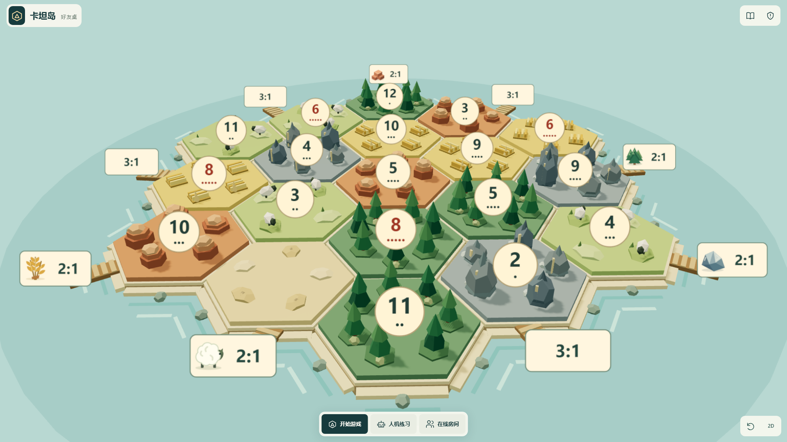
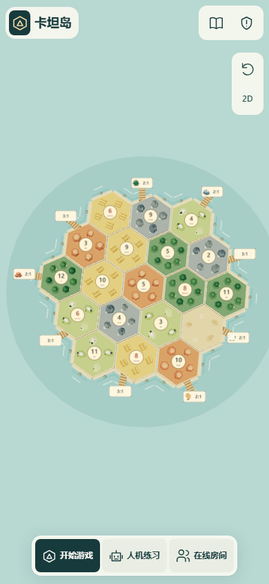
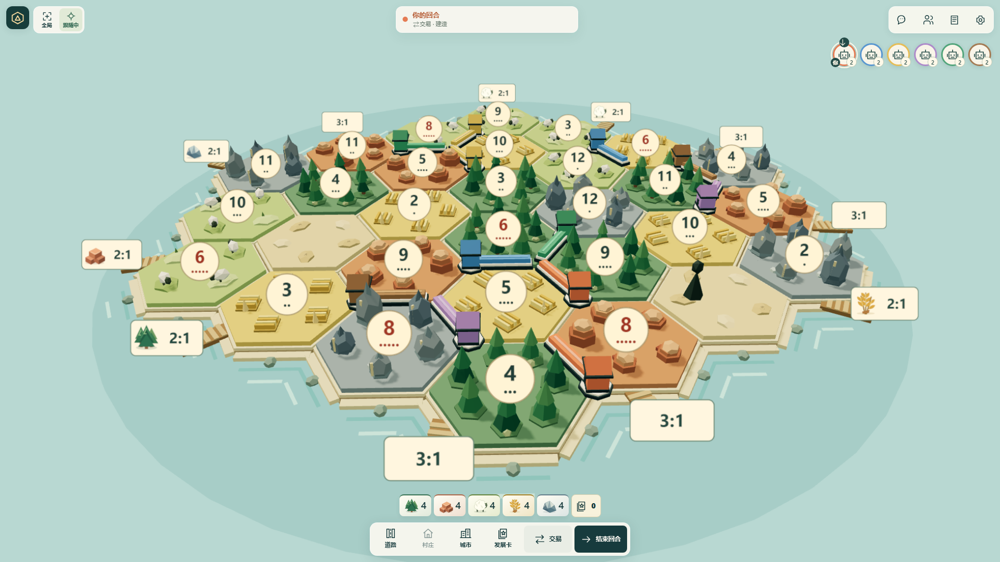
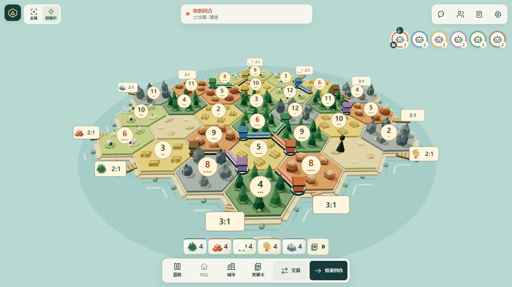
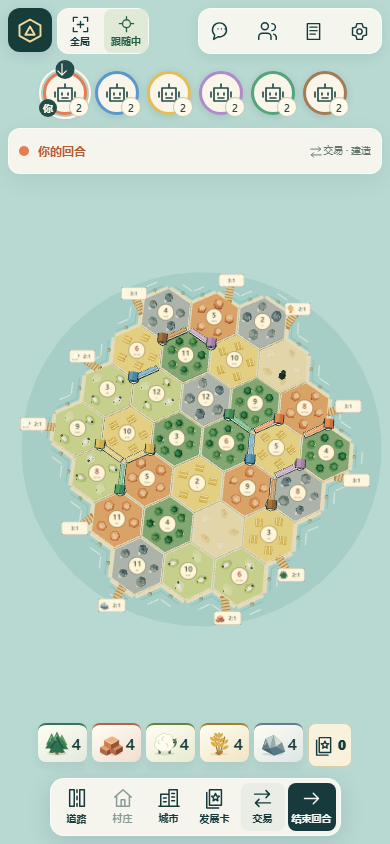
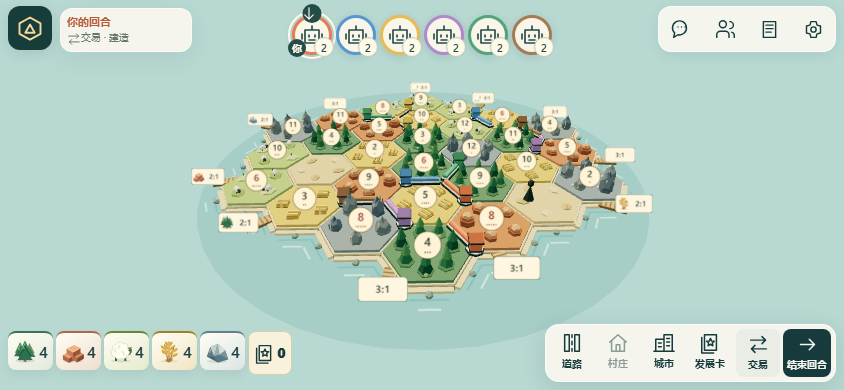
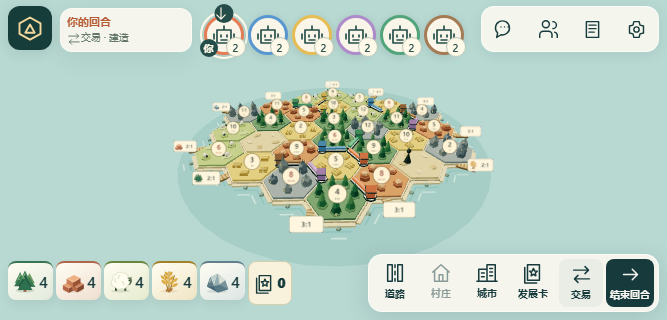
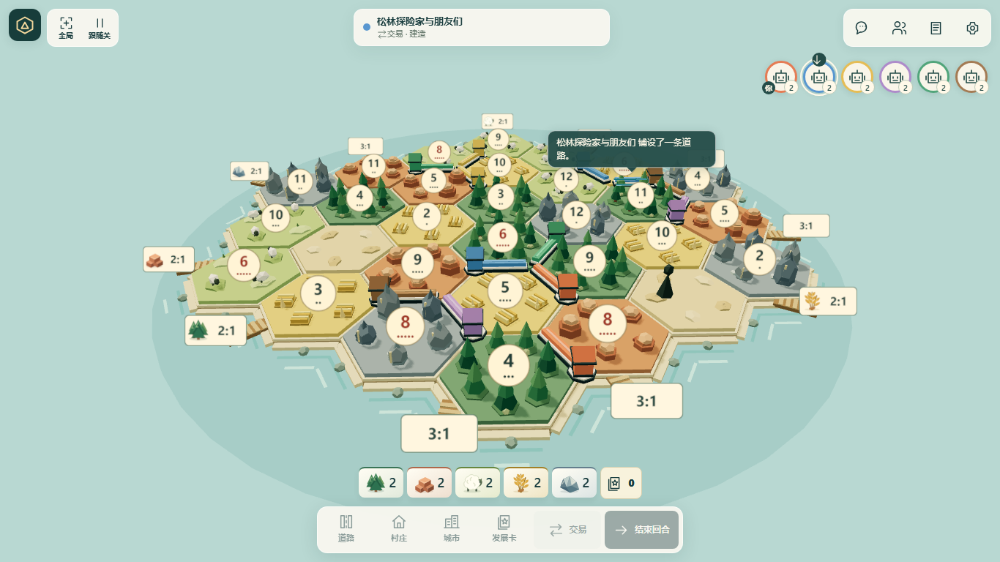
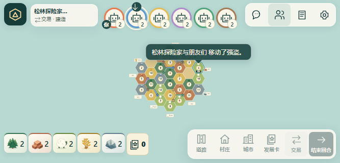
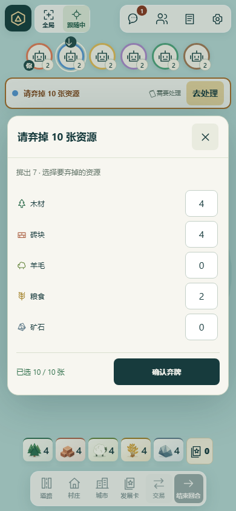
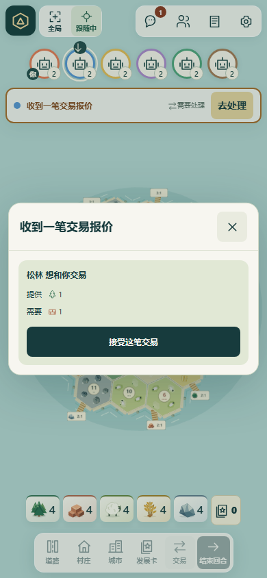
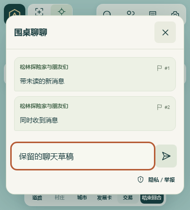

## 发布

保持唯一链路：**合并 main → 必要 Checks 成功 → 校验精确当前 main 的既有产物 → 原工作流自动发布阿里云和 Cloudflare。** 本 PR 不合并、不主动部署、不创建重复发布链，也没有手动触发远端 CI。完整浏览器验收保持本地执行，PR 仅使用仓库已有必要检查。
