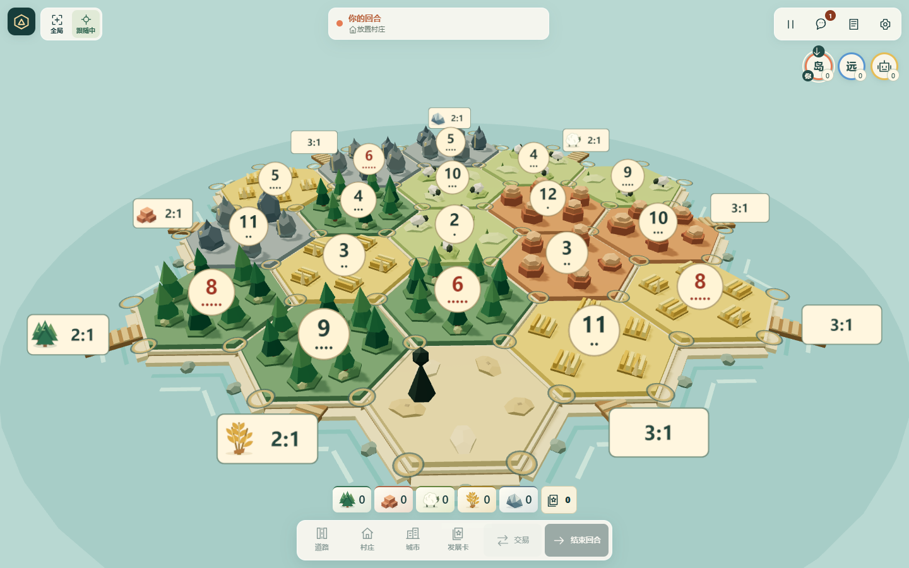
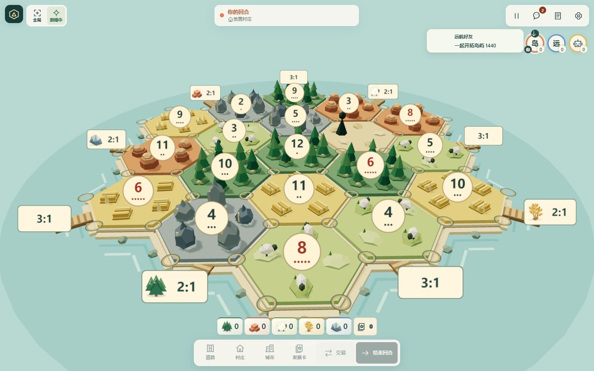
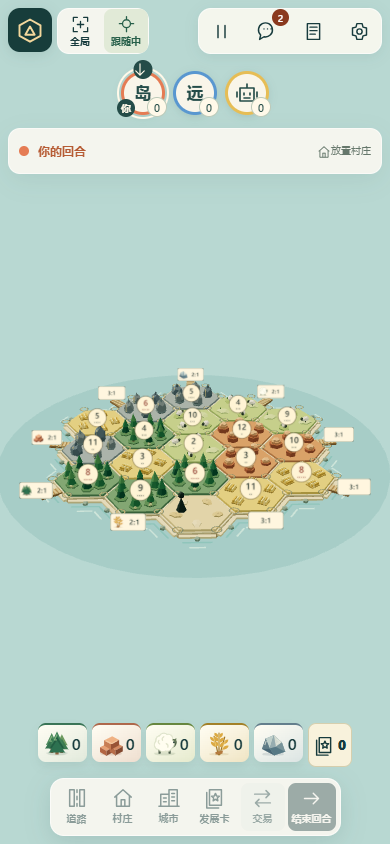
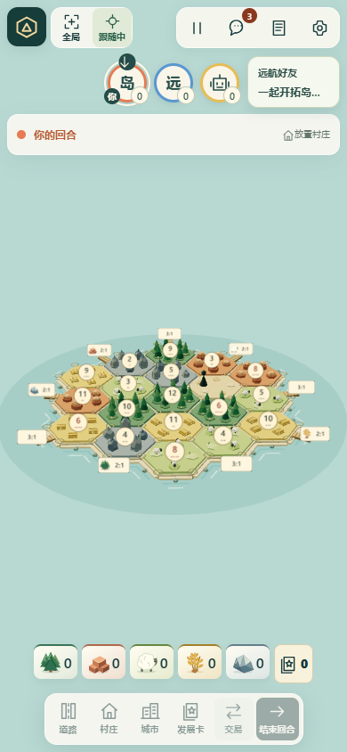
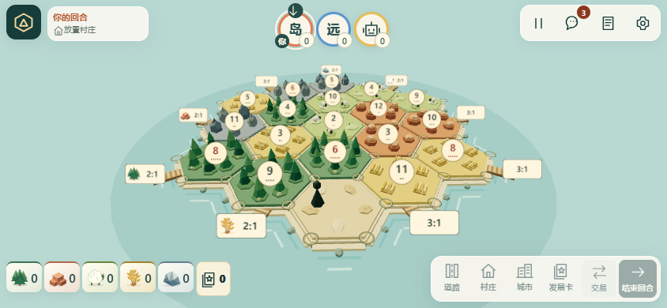
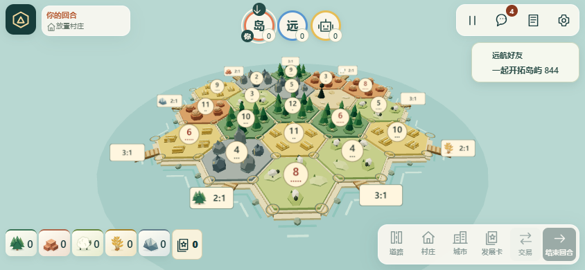
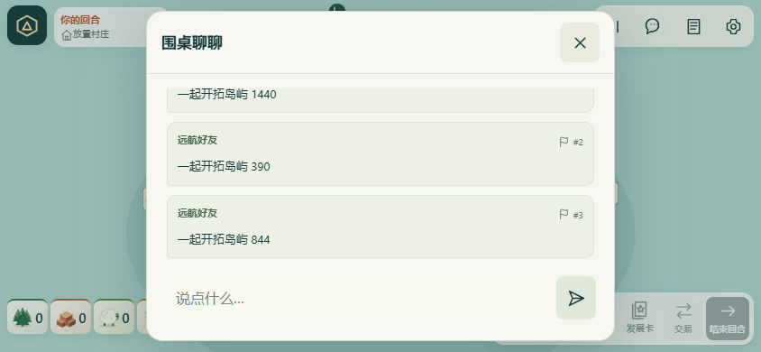
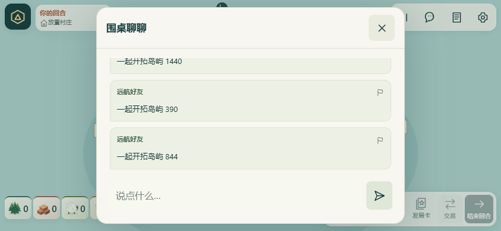

# 海外聊天预览与无编号记录

2026-11-06，基线 `46ec525`。before 截图在修改产品代码前保存；测试房间和昵称均为本地虚构数据。

海外新消息在实际聊天按钮附近显示一条合并后的最新预览，8 秒自动消失；打开聊天时不叠加气泡。布局避开玩家状态、操作区和投影后的岛屿范围，随着窗口、视角和视觉视口变化更新。手机空间紧张时用更窄的短预览；没有安全位置时保留未读入口及完整记录。气泡和记录不显示消息序号，举报按钮继续通过原内部 UUID 定位消息，举报详情使用发送者、时间和原文。

消息 ID、序号、服务器权威顺序、重试幂等、去重、重连和存档未修改。国内不创建聊天预览节点，固定随机昵称和禁交流政策不变；发布和服务器配置未修改。

## 本地结果

| 检查 | 结果 |
| --- | --- |
| `npm test` | **158/158** 通过 |
| `node scripts/chat-preview-browser.mjs` | global 通过；真实双客户端：候场及开局、1440×900 / 390×844 / 844×390、入口距离、状态与操作区不重叠、单预览、自动过期、无编号、刷新后 ID/顺序保留、实际断线重连时积压不弹出且后续新消息恢复 |
| `SITE_EDITION=cn node scripts/chat-preview-browser.mjs` | cn 通过；同样三种尺寸，无昵称输入、聊天入口或预览节点 |
| `node scripts/chat-report-browser.js` | 通过；三玩家并发落子/聊天、发送失败保留草稿、确认期间编辑、历史恢复、精确消息举报；适配现有准备按钮名称 |
| `node scripts/site-edition-browser.mjs cn` / `global` | 两版三尺寸昵称、候场、开始、恢复、同站点入口通过 |
| `npm run build:cn` / `build:global` / `worker:check` | 通过；最后一项为本地 dry-run，不发布 |

浏览器为 Windows Edge / Chromium。没有真实手机、iOS Safari、系统键盘或移动网络验收；安全区域和视口逻辑由浏览器尺寸模拟覆盖。没有增加远端 CI，也没有公网发布。

| 场景 | 修改前 | 修改后 |
| --- | --- | --- |
| 桌面新消息 |  |  |
| 手机新消息 |  |  |
| 横屏新消息 |  |  |
| 完整聊天记录 |  |  |

补充：[候场预览](after-global-lobby-preview.png)、[国内竖屏](after-cn-390-preview.png)、[国内横屏](after-cn-844-preview.png)。
