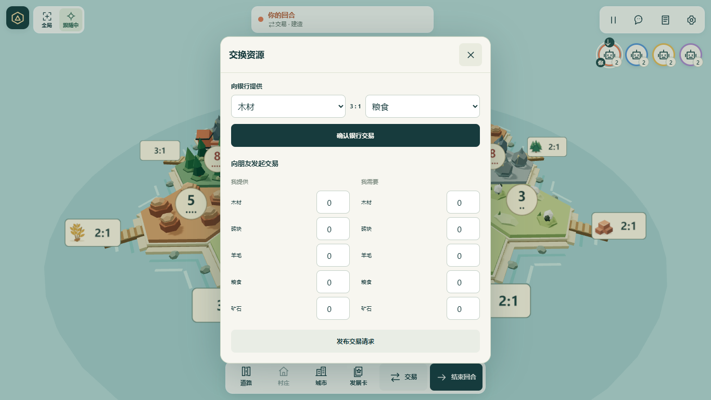
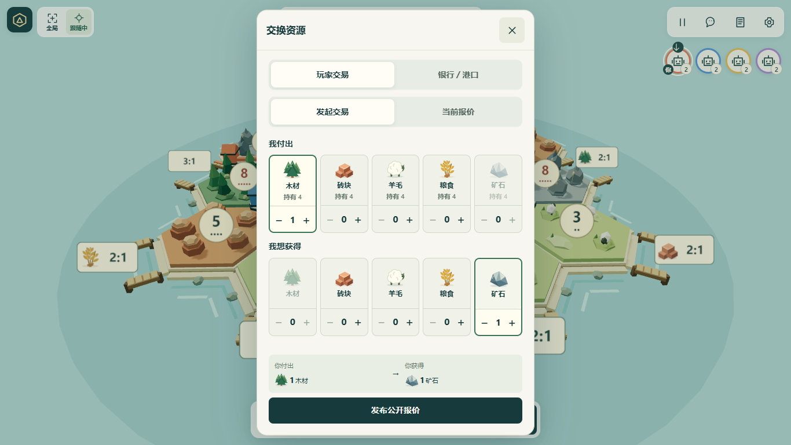
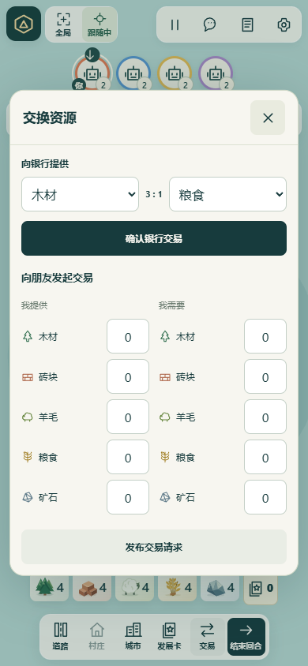
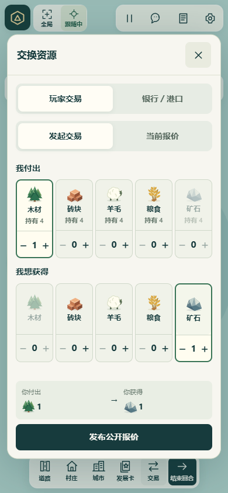
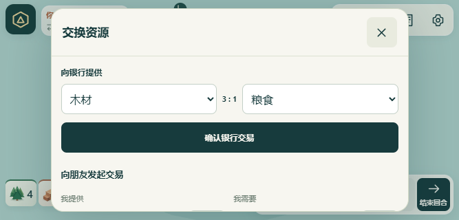
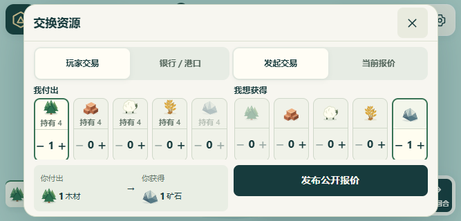

# 资源交易、港口与行动反馈验收

基于 `main` 的 `c08e4bf15b860b41f1edc502f4789f691c6aa9d8`，2026-11-08 在 Windows、Node 22.23.3、Edge Chromium 中运行。实现共用于国内和海外入口，站点隔离、国内固定昵称与禁用交流、海外交流功能保持原有策略。

## 实际改动

- 交易浮窗分为「玩家交易」「银行／港口」，玩家视图再切换「发起交易」「当前报价」。资源卡点击或加减选择，付款不超过持有量，两边不重复选择同种资源，显示交换预览。短横屏并排显示两组资源和底部提交；其他视口采用上下两组资源。
- 报价按照查看者视角显示付出与获得。发起者可撤销，接收者「接受并成交」；保持全桌单条公开报价、覆盖旧报价、直接成交的实际协议。报价通知使用非模态提醒与交易入口计数。关闭、Escape、系统返回与空白处关闭不取消报价，未提交草稿按房间与身份保留；刷新后恢复，国内仅保留资源数量和资源枚举，清除旧自由文本草稿。
- 银行比例调用共享 `tradeRatio`，自动使用 4:1／3:1／2:1 最优惠合法比例。显示手牌和库存，阻止不足、同种资源及阶段不符的提交；每次仅兑换一张。失败后请求权威状态同步。
- 2D、3D 均从 `port.edge` 与 `port.vertices` 生成端点和向海法线。替换原来的单个径向码头为连接两个有效落点的双栈桥；两端分别显示建筑拥有者颜色。点击港口可查看端点与比例；落点预览高亮相关港口。3D 码头沿用现有实例批次，没有独立模型下载。
- 建造入口始终可以查看共享 `COSTS` 的需求、持有和缺口；合法建造仍直接点地图，发展卡使用明确购买按钮。区分免费放置／免费道路、行动阶段、合法位置、棋子、牌堆与资源不足。
- 玩家记分面板显示最长道路、已打出骑士、启用时的港口建筑分、门槛、持有人及 +2 分。新增权威奖项转移事件，沿用现有去重游标与约 1.25 秒地图提示。
- 产出使用更清晰的暖金地形轮廓与短暂脉冲；强盗、抢劫和掷骰阻断采用紫灰轮廓，合并事件仍保留各目标的视觉类型。银行仅够单玩家部分领取时，只标记实际归因到的地块；没有发放的地块不播放产出。减少动态与低内存设备使用静态反馈，沿用已有镜头手动暂停与弹窗保护。

## 验证结果

| 检查 | 结果 |
| --- | --- |
| `node --test tests/*.test.js` | **170 / 170 通过**，包括 Node／Worker 现有隔离、存储与生命周期测试 |
| `node scripts/build-site.mjs cn` | 通过 |
| `node scripts/build-site.mjs global` | 通过 |
| `commerce-browser.mjs` | 国内／海外各 5 视口通过；触摸、关闭、Escape、浏览器返回、草稿恢复、报价发布撤销接受、实际银行兑换、费用查看、2D 港口键盘操作 |
| `commerce-edgecases-browser.mjs` | 国内／海外通过；刷新草稿、需求资源未持有、配对阶段银行、库存不足、发布后资源不足反馈、回合结束、发展卡耗尽 |
| `commerce-effects-browser.mjs` | 国内／海外 × 2D／3D 共 4 场景通过；真实产出、强盗阻断、抢劫隐私、重复消息、奖励和双端点显示／点击 |
| 现有 `action-feedback-browser.js` | 通过；10 张截图覆盖位置投影、缩放、1–1.5 秒清理、事件合并、输入焦点、刷新／重连与减少动态 |
| 现有 `viewport-stage-browser.js` 交互模式 | 通过；交易、弃牌、抢劫、草稿和输入节点保持、模拟键盘、2 个 CDP 安全区、暂停恢复与 2D／3D 手势 |
| `git diff --check` | 通过 |

新增规则测试还覆盖港口海岸边与两端映射、共享拥有权、道路或强盗不解锁／封锁港口、三档比例、交易原子失败、覆盖／撤销／失效报价、同版本双人接受只成交一次、存档恢复与收据重试、道路分叉／闭环／截断／平手／转移、军队与港口计分和胜利条件、免费建造及引擎费用一致。

视口为 1366×768、390×844、320×568、844×390、667×320。浏览器测试使用实际前端与共享 `act`／`viewFor` 的本地 WebSocket 协议夹具；新增并发测试使用 `Room.handle` 的版本与收据流程。完整测试中的既有网络测试另外覆盖真实 Node WebSocket 与重启。未接入真实公网多端对局，未进行实体手机、Safari／Firefox或真实低端设备性能测试；本次触摸测试为 Edge 模拟，不能当作真机结论。双端点多拥有者夹具用于验证显示与权限推导，不修改正常建造距离限制。

机器默认 Node 20 低于项目要求，所有检查通过 `npm exec --yes --package=node@22 -- node …` 执行。使用浏览器脚本时设置 `TEST_URL`、`TEST_EDITION=cn|global`，Windows 可设置 `BROWSER_CHANNEL=msedge`。国内截图来自本地生产构建，海外截图来自本地 Vite 游戏界面。

详细机器记录：[视口 global](results-global.json)、[视口 cn](results-cn.json)、[边界 global](edgecases-global.json)、[边界 cn](edgecases-cn.json)、[动效 global](effects-global.json)、[动效 cn](effects-cn.json)。保留代表性截图在此目录，完整本地截图归档在 `.local/commerce-screenshots/`，未把运行存档或构建产物提交到仓库。

同时同步了五份历史浏览器脚本的资源卡、报价和配对阶段选择器，补齐其部署夹具的站点标识，公共玩家面板助手改用现有头像入口；Node 22 语法检查通过。已运行其中视口脚本的 `VIEWPORT_PHASE=interactions` 模式，[机器记录](viewport-interactions-global.json)。五份历史脚本的所有页面矩阵没有在本次全量重跑；新版交易的跨站、跨屏与边界验收使用上述三份专用浏览器脚本。

## 运行前后截图

基线截图在修改界面前从上述主分支实际运行取得；使用与修改后相同的屏幕尺寸和规则夹具。

| 场景 | 修改前 | 修改后 |
| --- | --- | --- |
| 桌面交易 |  |  |
| 手机竖屏 |  |  |
| 短横屏 |  |  |

其他运行截图：[国内短横屏](after-cn-short-landscape-trade.png)、[银行](after-global-portrait-bank.png)、[费用](after-global-portrait-cost.png)、[港口 3D](after-global-shared-port-3d.png)、[港口 2D](after-global-shared-port-2d.png)、[产出](after-global-production-3d.png)、[阻断](after-global-blocked-2d.png)、[奖项](after-global-award-3d.png)。

本次没有启用子代理或 A/B 测试，没有新增远端 CI，没有修改发布工作流、凭据或主动部署。
