# 卡坦岛首页 · 同一家游戏入口

基线：2026-11-06 拉取的 `origin/main`，`4f15e4a2b1449ded4af0d2758da5b8060f8eb3aa`。本次在独立工作树上完成。

## 设计与范围

保留主分支的全屏海岛与三个直接入口。用深青绿作为操作色，海玻璃色作背景，浅纸色承载菜单；正文沿用本地系统字体，欢迎标题使用项目已有宋体栈。按钮和输入框采用 10–12px 圆角、44–48px 触控高度、8/12/16/24px 间距，轻阴影只用于浮动入口和对话框。对所有首页样式使用 `.at-home` 或既有首页 ID 限定。

- 「开始游戏」明确为「开桌 / 加入」，保留练习、在线房间和规则菜单。
- 当前服务器始终有文字标识；生产环境既有返回大厅链接保持原目的地址。
- 昵称、邀请码、公开/私密房、拓展规则保持原有交互和公开可见性，不增加菜单层级。
- 放大菜单正文和拓展卡片说明。横屏菜单采用两个独立起点的栏目，844×390 下两项拓展卡都能完整看到；更短视口可在对话框内滚动。
- 主操作、次级操作、输入、默认/悬停/键盘焦点/禁用状态成对指定颜色。
- 未修改 3D 地图、棋盘拟合、游戏规则、状态机、网络协议、服务器文件及发布工作流。

## 修改前后

所有截图均从本地实际 Node + Vite 首页生成。三种尺寸：1440×1000、390×844、844×390。

| 视口 | 修改前 | 修改后 |
| --- | --- | --- |
| 桌面 | 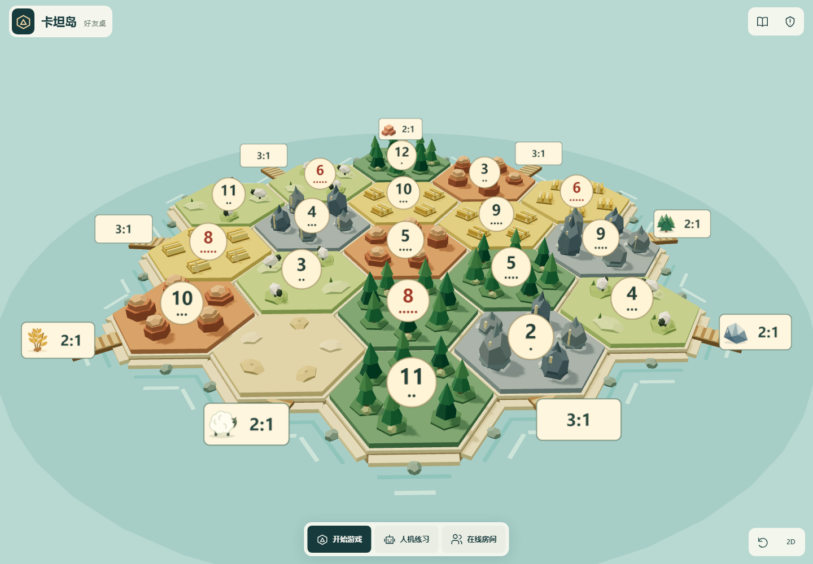 | 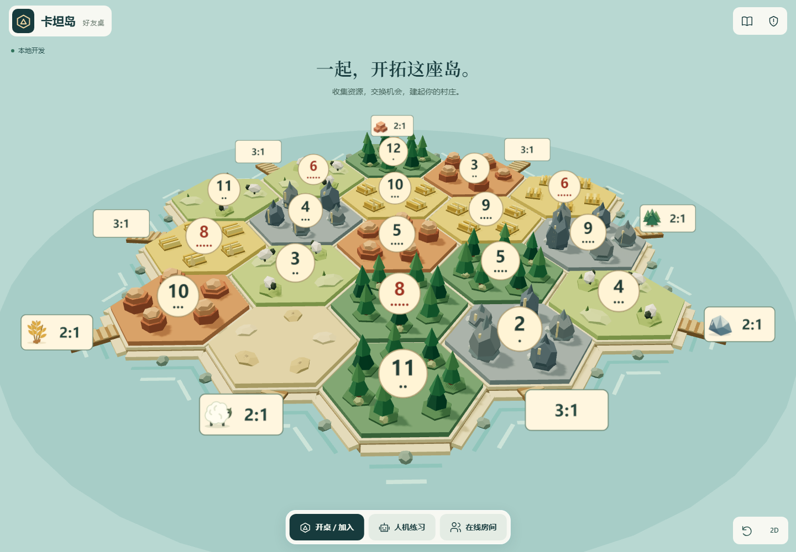 |
| 手机竖屏 | 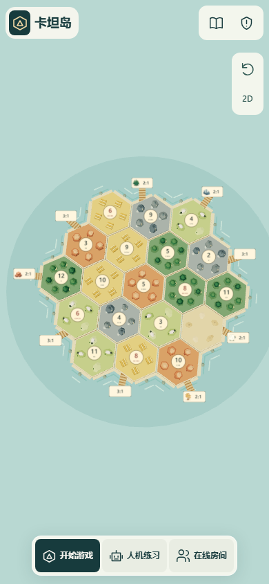 | 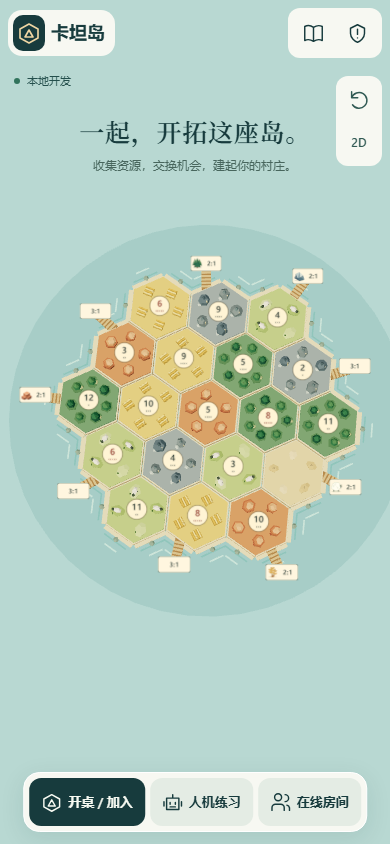 |
| 手机横屏 | 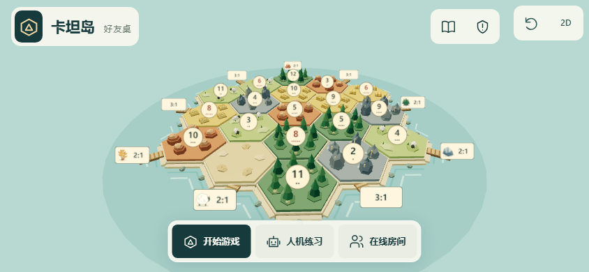 | 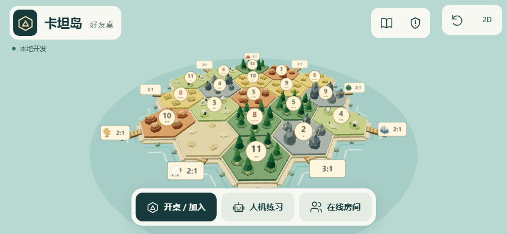 |
| 桌面开桌 | 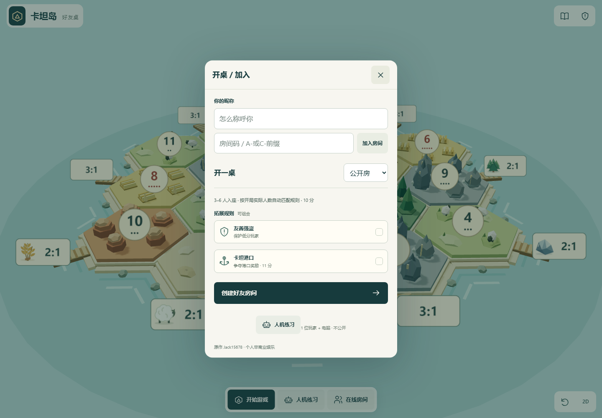 | 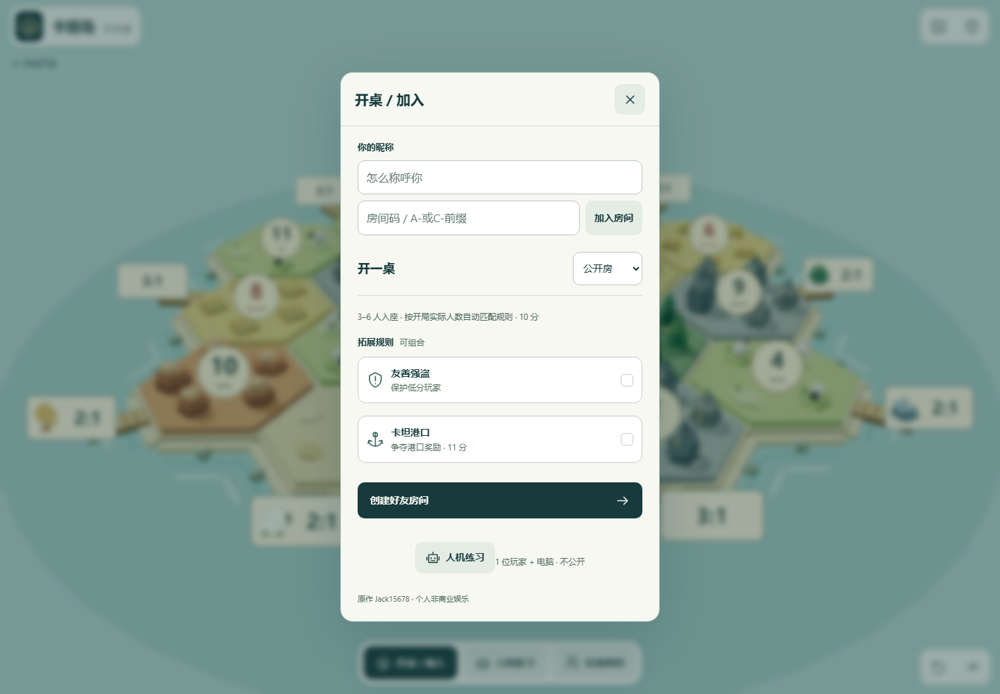 |
| 竖屏开桌 | 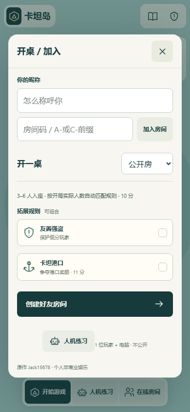 | 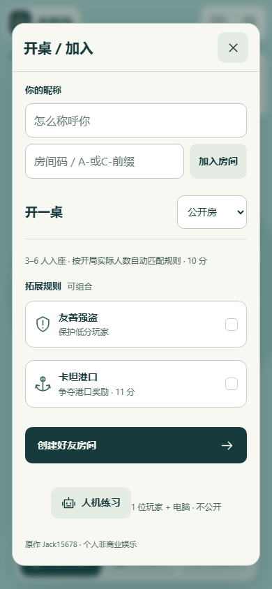 |
| 横屏开桌 | 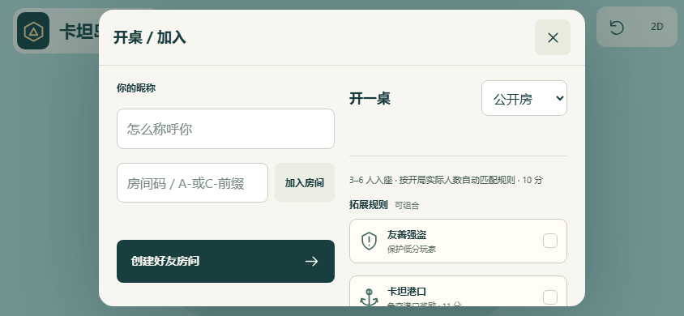 | 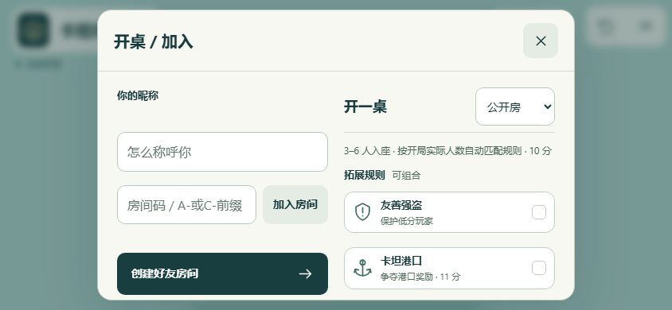 |

[阿里云入口提示](after-aliyun-portrait.png) · [Cloudflare 入口提示](after-cloudflare-portrait.png)。这两张仅在本地替换 `/api/deployment` 返回的身份标记；未访问或改变生产服务。

## 参考与素材

- [Impeccable](https://github.com/pbakaus/impeccable)：以层级、可读性、间距、交互状态、响应式和删减装饰为审查切入点。
- [frontend-design](https://github.com/anthropics/skills/blob/main/skills/frontend-design/SKILL.md)：采用与海岛题材相符的视觉方向，先定义颜色、字体、布局和控件原则，再检查实际截图。
- 未安装、运行或复制参考仓库的脚本；本次 CSS 与欢迎文案为仓库内新写。
- 素材全部沿用项目已有程序化 Three.js 棋盘、`src/icons.js` 的 SVG 线性图标与系统字体。未引入外部图片、字体包或素材授权依赖，棋盘不是 Blender 资产。

## 验证

- `npm run build`：通过。
- `npm test`：143/143 通过。
- `node scripts/entry-design-browser.js`：Chromium + WebKit 共 10 组视口通过（上述三组加 320×568、667×320），无页面错误、全页溢出、首页按钮重叠或越界；检查触控高度、昵称/公开性/拓展草稿保留、焦点、练习人数、规则和在线房间菜单。
- `node scripts/entry-design-flows.js`：真实本地建房、独立访客邀请加入、3 人练习开局通过；两种服务器标记下的返回大厅链接、A-/C-邀请码及跨服拒绝通过。
- `TEST_URL=http://127.0.0.1:5183 MAP_ENGINE=chromium node scripts/map-first-browser.js`：既有地图首页与对局验收通过，18 张检查截图覆盖完整海岛、港口、控件、玩家面板、聊天草稿、刷新和 2D/3D。生成的既有截图未纳入此 PR。
- 实测计算样式对比：主按钮 11.51:1、次级按钮 10.07:1、输入正文 12.14:1、禁用按钮 4.72:1；键盘焦点使用独立铜色轮廓。悬停色 `#285c56` + 白字。
- 人工逐张查看上述首页及菜单 before/after 截图。截图完整清单与视口结果见 [check-results.json](check-results.json)。

复现时先以独立本地端口启动 `createServer({development:true,port:5183})`；两个新脚本也支持 `TEST_URL` 环境变量。无需触发远端 CI。

## 未验证

未在实体 iPhone/Android、系统键盘、真实移动网络上验收；WebKit 模拟不代表设备 Safari。未进行生产发布或远端端到端测试。原有 main 检查通过后发布阿里云和 Cloudflare 的工作流文件保持不变，没有增加发布链路。
