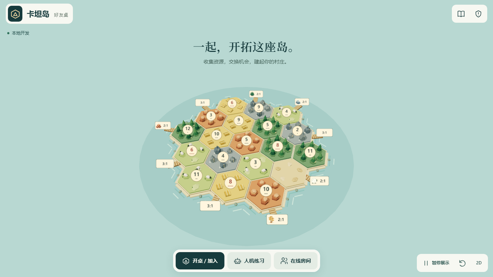
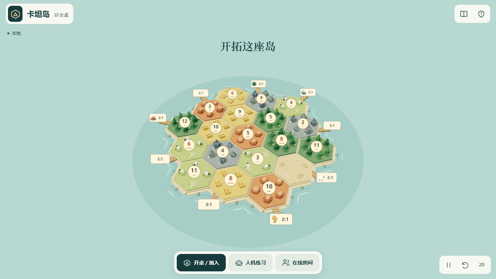
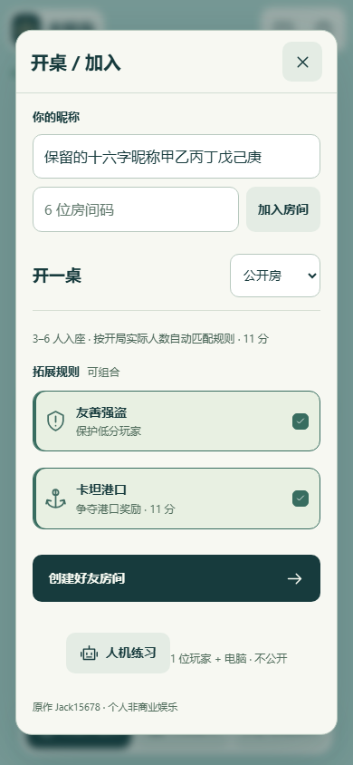
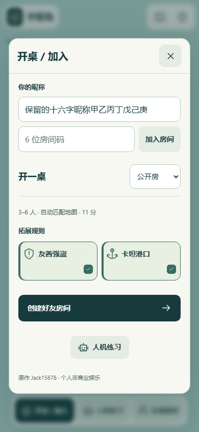
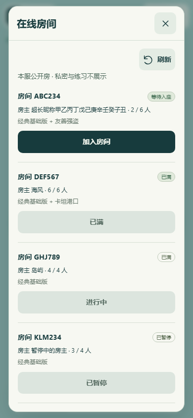
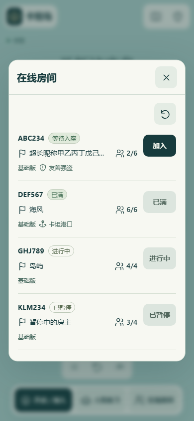
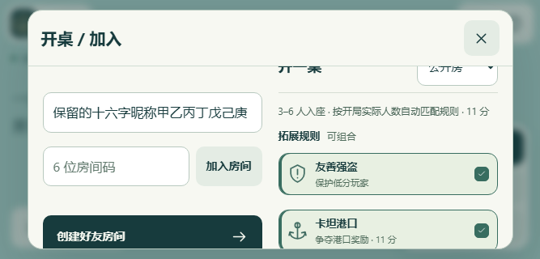
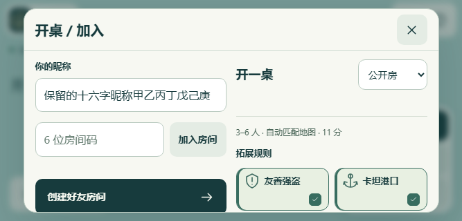

# 卡坦岛：以岛屿和选择为先

基线为 2026-11-06 拉取的 `origin/main`：`7baa5cc5743efbb20a286a0aaa9b032d0399a2bb`。本次只调整客户端显示及本地验收脚本。保留已有全屏海岛、三维/二维棋盘、镜头跟随、行动反馈、建筑落点、资源插画、浮动操作与原生对话框。服务器、房间、规则、安全、邀请格式、部署工作流与凭据没有改动。

先查看实际页面：旧首页已经隐藏两侧栏、重复的旧首页介绍与棋盘教程；规则和设置入口已经使用 SVG。这些隐藏文案和既有图标不计作本次优化成果。

| 实际可见项 | 本次处理 |
| --- | --- |
| 首页标题加玩法宣传副句 | 保留一个短标题，删除副句；地图展示和三个直接入口保留 |
| 国内/海外技术线路名称 | 改为“国内站 / 海外站”；本地显示“本地” |
| 返回大厅、暂停首页展示、刷新 | 复用现有 SVG，提供名称、悬停提示、键盘焦点与 44px 触摸区 |
| 建房逐行选项、解释及长规则匹配句 | 两张直接可见的短名选择卡；选中有勾选形状、边框和背景；说明在现有规则窗口与选项提示中查看；保留人数、自动匹配地图和胜利分数 |
| 人机练习重复解释 | 删除“1 位玩家 + 电脑 · 不公开”；人数按钮和电脑数量仍直接可见 |
| 房间列表的逐行说明与全宽按钮 | 紧凑房间码/状态、房主旗帜/昵称、人物/人数；旁侧保留加入或禁用状态；列表仅呈现实际规则和已选拓展 |
| 满座进行中房间状态 | 显示“进行中”，人数仍显示满座；不再错误优先显示“已满” |
| 国内规则中的“聊天仍可用” | 按站点模式显示，国内不再出现与实际禁用聊天冲突的句子 |
| 短横屏玩家头像触摸区 | 从 40px 恢复到 44px，调整候场间距；短横屏建房主要按钮位于窗口初始可见区域 |

## 前后截图

截图来自本机浏览器真实渲染。`before-*` 通过本地响应替换加载固定基线的 `src/main.js`，其余样式与美术为未改动基线文件；`after-*` 加载工作树代码。六人对局/结算为真实规则投影的本地协议夹具，`cn-*` / `global-*` 为相应正式构建连接本地 Node 服务器后的真实建房、开局与设置页面。

| 页面 | 修改前 | 修改后 |
| --- | --- | --- |
| 桌面首页 |  |  |
| 手机竖屏建房 |  |  |
| 手机竖屏房间列表 |  |  |
| 手机短横屏建房 |  |  |

其他证据：[六人短横屏对局](after-action-short-landscape.png)、[竖屏结算](after-finished-portrait.png)、[国内竖屏昵称/建房](cn-390-entry.png)、[国内横屏对局](cn-844-game.png)、[海外竖屏设置](global-390-settings.png)。目录保留五种尺寸的首页、加入/建房、练习、房间列表、错误和规则截图，以及四种尺寸的候场、对局、结算与设置截图。

## 本地验证

| 检查 | 结果 |
| --- | --- |
| `npm test` | 158/158 通过；包括昵称/聊天权限、邀请前缀与房间隔离、重连重试、私人投影、人数自动匹配及规则测试 |
| `npm run build:global`、`npm run build:cn` | 两种正式构建均成功 |
| `TEST_URL=http://127.0.0.1:5213 node scripts/visual-first-browser.js --before` | 五种尺寸基线截图成功 |
| `TEST_URL=http://127.0.0.1:5213 node scripts/visual-first-browser.js` | 17 个场景通过；1366×768、390×844、844×390、320×568、667×320；关键触摸区/边界/互不重叠、无整页滚动、短横屏创建按钮、长昵称、满员/进行中/暂停、错误与重试、键盘选项、关闭后的昵称/勾选草稿、交易草稿与不误提交 |
| `POLISH_ENGINE=chromium TEST_URL=http://127.0.0.1:5213 node scripts/immersive-polish-browser.js` | 原有沉浸流程全部通过，30 张截图；3–6 人候场、开局自动地图、二维/三维落点、暂停权限、必选弃牌、聊天与交易草稿、点击空白/Escape/系统返回、结算与再来一局 |
| `node scripts/site-edition-browser.mjs global` | 海外正式构建：1280×800、390×844、844×390，自定义昵称、聊天发送、建房/电脑/开局、设置/规则关闭和刷新身份恢复通过 |
| `node scripts/site-edition-browser.mjs cn` | 国内正式构建：同三种尺寸，固定随机昵称与换名、旧自由昵称清理、无聊天/举报入口、建房/电脑/开局、设置/规则关闭和刷新身份恢复通过 |
| `git diff --check`、`node --check src/main.js` | 通过 |

原沉浸夹具补全当前入口校验要求的 `siteEdition`，使回归真正进入页面；没有改变协议或生产逻辑。双版本脚本新增竖屏及设置/规则验证，关闭窗口后等待原有历史记录清理完成再刷新。

本次没有调用远端 CI、合并或生产部署，提交使用 `[skip ci]`；保留合并 main 后原有自动发布链。仓库现有发布器只接受精确当前 main 的成功 push 检查；既有文档记录 Catan 没有 Native Builds 连接，本次未改变或重新查询云端设置。

## 未覆盖项

本次浏览器为 Chromium 模拟视口和触摸，未在实体 iPhone/Android、设备 Safari、系统键盘、物理旋转、真实移动网络与持续断网环境验收；没有以本地模拟宣称这些已经通过。未进行公网端到端或负载验证。WebSocket 重试/断连行为有既有本地协议测试，浏览器本轮覆盖读取失败与刷新恢复，未新增所有网络故障时序的浏览器测试。
