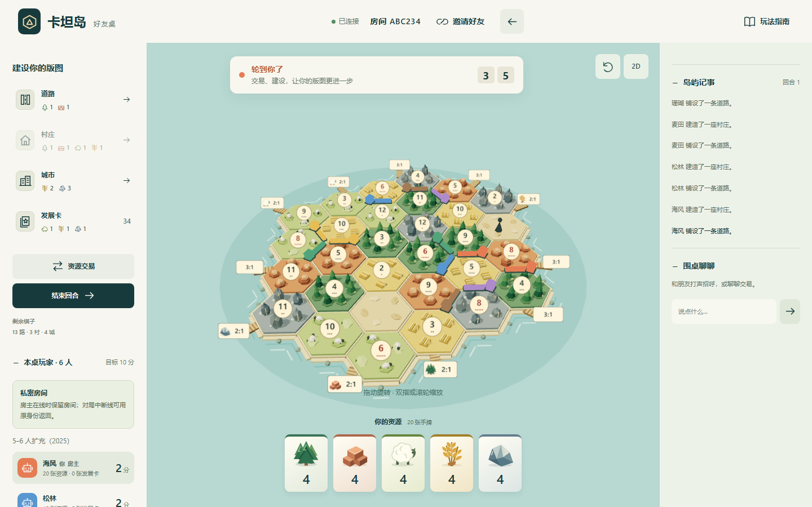
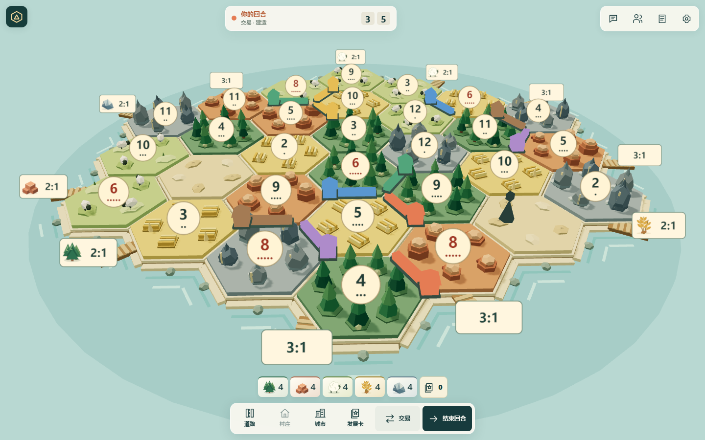
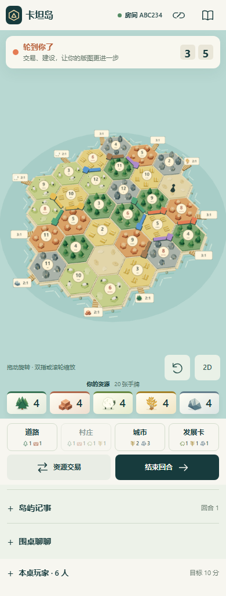
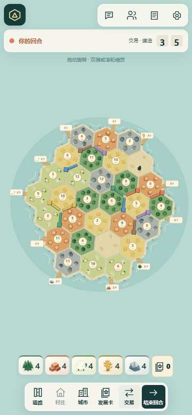
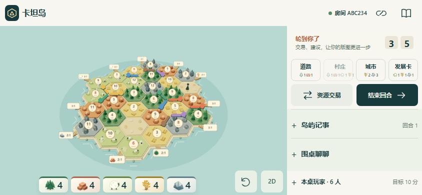
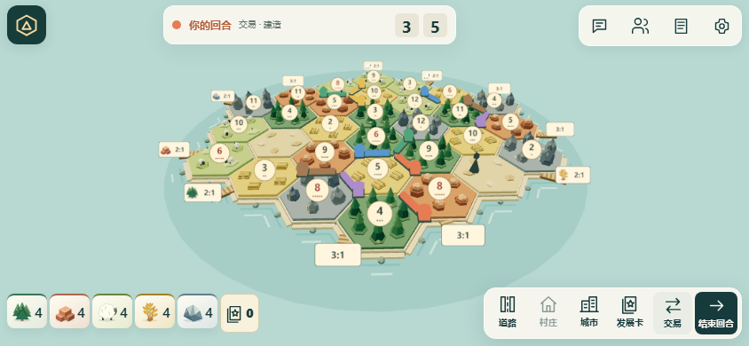

# 视口游戏舞台验收（2026-11-06）

基于 `qiuh23/catan-friends` 最新 main `8629793`。本次只重构进入对局后的界面；大厅与建房继续按原布局滚动。

## 对局行为

- 电脑、手机竖屏和横屏统一为 `100dvh` 固定舞台。3D canvas / 2D SVG 的容器铺满视口；顶部大栏和固定左右面板不再占据地图空间。
- 浮动的小型卡坦标志、聊天 / 玩家 / 记录 / 设置按钮，配合始终可见的回合、资源、发展卡数量、建造、交易及结束回合入口。图标由项目自己的 SVG 路径绘制，交互按钮提供辅助名称、状态及提示。
- 弃牌、收到的交易报价、选择偷取对象及暂停状态主动打开对话框。关闭或 Escape 仅隐藏对话框；回合提示保留“去处理”入口，不提交选择、不自动弃牌/接受报价/选对手。收到报价时优先显示该报价，不会排在原交易编辑器后面。
- 聊天、玩家、记录、手牌和设置各自一键打开，可关闭。长表单仅在对话框内滚动；关闭、消息更新与旋转保留输入草稿。聊天记录单独更新，保留正在输入的 DOM 节点、焦点和中文组合输入环境。表单错误在对话框内部显示，避免外层 toast 被遮挡。
- 模态层不参与棋盘尺寸和相机计算。按视口与稳定 HUD 安全范围取景，包含港口文字；手动旋转、缩放通过实际视口变更保留。屏幕方向仅影响初始/手动复位取景，不跟随他人行动。
- 安全区包含在控件位置和地图可见边界内；横屏按扣除安全区后的可用宽度精简资源条，极窄时改为两行下沿控件，避免手牌按钮与建造重叠。对话框跟随 visualViewport 高度和偏移。2D 保留键盘 Tab/Enter，并支持平移、双指/滚轮/加减键缩放和复位；拖拽/双指手势不会顺带落子。
- 规则引擎、房间协议、公开/私密数据投影、存档及 3–6 人/全部现有变体未改；房间连接状态与设置、暂停、房主转交、暂离、解散、返回原大厅仍可用。

## 前后截图

下列前后截图来自相同的六人确定性对局。修改前直接运行 main；修改后运行本分支。全页截图可检查旧竖屏页面长度及新页面边界。

| 视口 | 修改前 | 修改后 |
| --- | --- | --- |
| 电脑 1440×900 |  |  |
| 竖屏 390×844 |  |  |
| 横屏 844×390 |  |  |

关键操作截图：[聊天输入](screenshots/viewport-after-chat.png)、[弃牌](screenshots/viewport-after-discard.png)、[收到交易](screenshots/viewport-after-incoming-trade.png)、[偷取对象](screenshots/viewport-after-steal.png)、[短横屏](screenshots/viewport-after-short-landscape.png)。

## 本地检查与边界

以下全部通过：

| 检查 | 结果 |
| --- | --- |
| `npm test` | 82/82，包含原有基础/拓展/联机/隐私及新增实际地图投影边界检查 |
| `npm run build` | 生产构建成功 |
| `npm run worker:check` | 本地 Worker dry-run 打包成功，未发布 |
| `npm run test:browser` | 真实本地练习房、开局、页面及2D/3D |
| `npm run test:multiplayer` | 三个独立身份、真实 WebSocket、3D 落子与聊天 |
| `npm run test:integration` | 原大厅返回、服务器入口及邀请隔离 |
| `node scripts/room-experience-browser.js` | 本地4/6真人完整房间和初始摆放、重连、权限、暂停及配对阶段 |
| `npm run test:terrain` | 16组布局、实际3D触控落点、聊天/手牌不重绘、按需渲染与GPU资源释放 |
| `npm run test:viewport` | 24组3–6人布局与96次面板开关；无主页面纵向滚动、canvas铺满视口、相机/地图尺寸不变；关键操作、输入草稿、同一聊天输入DOM节点、错误提示、2D手势与内部滚动 |

矩阵覆盖每种3/4/5/6人数的1440×900、390×844、844×390、740×320、568×320、320×568。另用Chromium CDP覆盖真实CSS环境变量的390×844（顶部32、底部24）和667×320（左右59、底部21）安全区模拟，检查按钮/资源/回合提示互不重叠，弹窗及聊天输入可见。键盘空间模拟缩为390×430；模拟composition事件并确认消息更新保留同一个输入节点，不能替代真实输入法/系统键盘验收。

修改前390×844的页面高度为1028；修改后各矩阵用例断言document.scrollHeight不大于视口高度、scrollY为0。每次打开/关闭玩家、记录、设置、手牌层均比较canvas边界与相机数据完全一致。

环境：Windows、Node26.13.0、Chromium156.0.8078.4、SwiftShader。所有浏览器结果为 Windows / Chromium 及触控、视口和键盘空间模拟。浏览器截图经过实际查看；未验证实体手机、Safari、系统键盘行为、真实刘海或移动网络。

常规 browser / multiplayer / room-experience 使用真实本地 Node 房间；罕见交易、弃牌和偷取对象由仅限 loopback 的协议夹具确定性触发，服务端规则另由全套单元/联机测试覆盖。夹具和测试入口不进入生产客户端。

没有新增依赖、外部图片、远端 CI 工作流，也没有手工触发远端 CI。评审提交使用 `[skip ci]`；原有发布工作流保持不变。本次交付 PR，不合并或部署。
